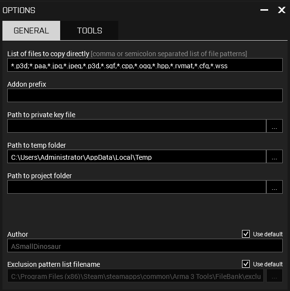

## 📚 Directory
Some addons are a part of [`tsp_core`](tsp_core) while others just depend on it. This repository contains [`tsp_core`](tsp_core) and any addons that are built into it such as [`tsp_ragdoll`](tsp_core/scripts/ragdoll.sqf), [`tsp_light`](tsp_core/scripts/light.sqf), etc. It also contains smaller addons that don't require their own repository.

Below you can find a directory to all of our other repositories:

Addon |  | 
-|-
[Core](https://github.com/TheSpeshalPlatoon/A3-Core) | [](https://steamcommunity.com/sharedfiles/filedetails/?id=3283642267)
↳ Crash | []()
↳ Ragdoll | []()
↳ Immerse | []()
↳ Lights | []()
↳ Tracker |  []()
[Animate](https://github.com/TheSpeshalPlatoon/A3-Animate) | [](https://steamcommunity.com/sharedfiles/filedetails/?id=3283612524)
[Breach](https://github.com/TheSpeshalPlatoon/A3-Breach) | [](https://steamcommunity.com/sharedfiles/filedetails/?id=3283645995)
[Melee](https://github.com/TheSpeshalPlatoon/A3-Melee) | [](https://steamcommunity.com/sharedfiles/filedetails/?id=3283652320)
[RHS Additions](https://github.com/TheSpeshalPlatoon/A3-RHS-Additions) | [](https://steamcommunity.com/sharedfiles/filedetails/?id=3553838240)
Gore | []()
Music | []()
[Missions](https://github.com/TheSpeshalPlatoon/A3-Missions) | []()

## 🗼 Structure
You may have noticed that some of the addons don't actually contain any code, why is this? Well, some of the addons in this repository are built into [`tsp_core`](Core/src/branch/main/tsp_core).

For example [`tsp_ragdoll`](tsp_core/addons/ragdoll.sqf) is a *dummy* addon, it has nothing in it, the code is actually in [`tsp_core\scripts\ragdoll.sqf`](tsp_core/scripts/ragdoll.sqf), however [`tsp_ragdoll`](tsp_core/scripts/ragdoll.sqf) must still be loaded alongside [`tsp_core`](tsp_core) for it to activate. This was done so that certain addons could serve as both a mission script and a standalone mod as [`tsp_core`](tsp_core) can be loaded as a mod or intergrated into a self-contained, mission file.

The addons in the other repositories are not built into [`tsp_core`](tsp_core) but may still require it. To find the requirements for each addon, check the `requiredAddons` entry in the `config.cpp` of the addon in question.

#### Community Base Addons
Most of the addons use [Community Base Addons (CBA)](https://steamcommunity.com/workshop/filedetails/?id=450814997) for settings and keybinds. They can be found in the escape menu, under controls and options.

Some addons use `tsp_fnc_keybind` and `tsp_fnc_setting` instead. This is to allow the use of these addons in a mission file. If [CBA](https://steamcommunity.com/workshop/filedetails/?id=450814997) is not loaded, settings can be configured on the map and keybinds cannot be changed.

## 🔨 Build
All TSP addons are built using Addon Builder from the [ArmA 3 Tools](https://store.steampowered.com/app/233800/Arma_3_Tools/) using the following settings:

  

```
*.paa;*.jpg;*.jpeg;*.png;*.sqf;*.hpp;*.ogg;*.wss;*.wav;*.xml;*.rvmat;
```